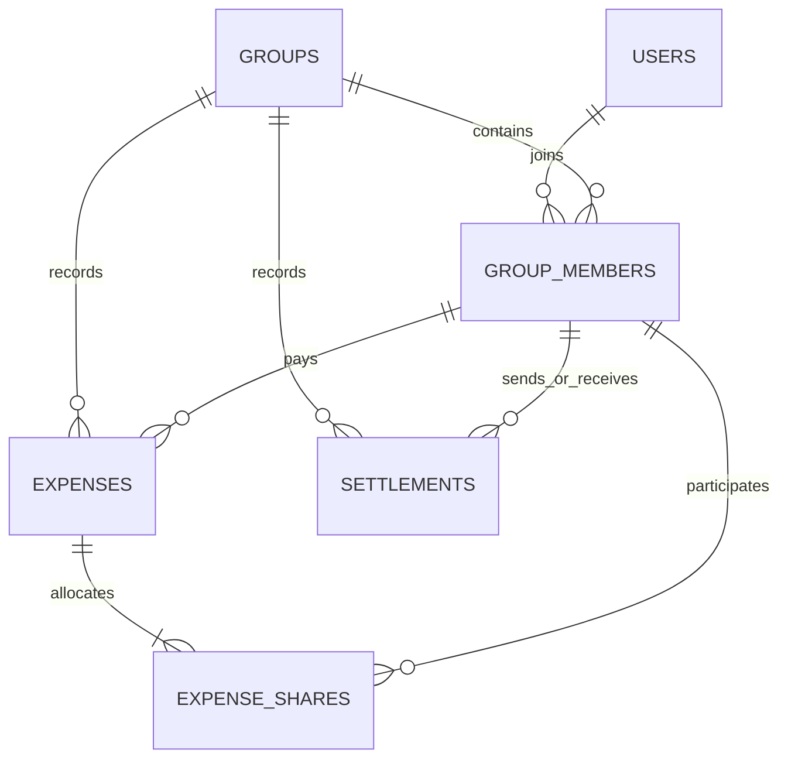

# Expense Sharing App

FastAPI expense-sharing backend with exact monetary accounting, searchable history, explainable spending analytics, and bounded optimal settlement suggestions.

**Status: implemented and verified.** The expanded PostgreSQL suite passes **83 tests**, including audit regressions, migration safety, and concurrent snapshot reporting. Docker build/startup and the live assignment scenario pass. The public repository is [expense-sharing-app](https://github.com/manansethi1205/expense-sharing-app); its name and description match the submission. [GitHub Actions](https://github.com/manansethi1205/expense-sharing-app/actions) runs the full checks on every push. See [verification details](docs/verification.md).

## Assignment scope

The submission includes three standalone, illustrated-by-example PDF guides:

| Guide | Contents |
| --- | --- |
| [Setup Instructions](output/pdf/setup-instructions.pdf) | Docker/local Python setup, configuration, migrations, tests, Postman and troubleshooting |
| [API Documentation](output/pdf/api-documentation.pdf) | All 25 HTTP operations, parameters, JSON model fields, validation, worked expense/settlement examples, search and analytics semantics |
| [Database Schema Explanation](output/pdf/database-schema-explanation.pdf) | Relationships, all six tables, constraints/indexes, exact money accounting, transaction boundaries and migration tradeoffs |

Download the [Postman collection](output/expense-sharing.postman_collection.json), or the [complete documentation bundle](output/expense-sharing-documentation.zip). Import the collection into Postman and run it from the first request; returned IDs are captured automatically. The PDFs describe code revision `c5a0a64`, API version `0.1.0`, and schema head `0002`.

The implementation covers users, groups, membership, equal shared expenses, history, structured balances, search, spending analytics, category suggestions, settlement suggestions, recorded settlements, custom splits, tests, and Docker support.

Search is the nominated mandatory product enhancement. Analytics and settlement suggestions are additional enhancements. Custom splits, settlements, tests, and Docker cover every optional bonus in the assignment.

## Stack

| Component | Choice | Reason / cost |
| --- | --- | --- |
| Backend | Python + FastAPI | Familiar framework; typed validation and generated OpenAPI documentation |
| Validation/configuration | Pydantic v2 + pydantic-settings | Explicit request/response contracts and environment configuration |
| Persistence | PostgreSQL | Transactions, constraints, reporting SQL, and row locking in one database |
| ORM | SQLAlchemy 2, synchronous sessions | Explicit transactions; less concurrency plumbing for a small assignment |
| Driver | Psycopg 3 | PostgreSQL driver; binary installation variant for a quick local setup |
| Migrations | Alembic | Reviewable, reproducible database changes |
| Server | Uvicorn | ASGI server for FastAPI |
| Tests | pytest + HTTPX2 / FastAPI TestClient | Pure accounting tests plus API/database integration tests; supported by the installed Starlette TestClient |
| Tooling | Ruff | One formatter/linter, minimal configuration |
| Packaging | uv + pyproject.toml + uv.lock + requirements.txt | Locked development environment and hashed runtime export |
| Delivery | Dockerfile + Docker Compose | API and PostgreSQL; persistent database volume |

Python 3.12+ is required. Exact dependency versions are recorded in `uv.lock`; `requirements.txt` is the hashed runtime-only export used by Docker. Key installed versions: FastAPI 0.143.2, SQLAlchemy 2.0.54, Pydantic 2.14.1, Psycopg 3.3.6, Alembic 1.20.0, and HTTPX2 2.13.1 (development only). Runtime dependencies also include tzdata so IANA timezone handling works on Windows.

FastAPI documents its OpenAPI and interactive documentation support in its [official features guide](https://fastapi.tiangolo.com/features/). SQLAlchemy documents the [transaction context](https://docs.sqlalchemy.org/en/20/orm/session_transaction.html) used by the service layer; Alembic provides [schema migrations](https://alembic.sqlalchemy.org/en/latest/).

### Why a relational database rather than a graph database?

Users and groups have relationships, but the required queries are membership lookups, time-ordered history, sums, and balance calculations. None requires repeated multi-hop social traversal. The workload does not establish that a graph database would be faster. A graph database would introduce another query model and make the listed SQL database options less directly applicable.

PostgreSQL stores relationships using foreign keys and association tables. We can construct a debt graph in memory when generating settlement suggestions. This demonstrates graph reasoning without adding an operational dependency.

SQLite is a valid fallback if zero-service startup matters more than concurrent settlement handling. It is not a second supported backend in the initial plan: supporting and testing two databases spends time without helping this assignment. If selected instead, enable foreign keys on every connection and revisit write concurrency; see [SQLite foreign key documentation](https://www.sqlite.org/foreignkeys.html). PostgreSQL is the recommendation for Docker-based evaluation.

## Architecture

One application, one database, and four straightforward layers:

```text
HTTP request -> FastAPI router + Pydantic validation
             -> application service (business rules + transaction)
             -> SQLAlchemy queries/models -> PostgreSQL

Application services -> pure money/split/balance/category/settlement functions
```

Ordinary synchronous route functions call synchronous database operations. One session per request; write services own commit/rollback boundaries. Pure accounting functions do not know about FastAPI or the database. Queries live in `services.py`, `search.py`, and `reporting.py`; no generic repository abstraction is needed at this size.

See [flow.md](flow.md) for actual modules, callers/callees, transaction boundaries, and error paths, and [decisions.md](decisions.md) for reasons and tradeoffs.

## Database design



| Table | Important fields | Constraints / purpose |
| --- | --- | --- |
| `users` | `id`, `name`, `created_at` | Nonblank trimmed name; names need not be unique |
| `groups` | `id`, `name`, `currency`, `timezone`, `created_at` | INR only initially; reporting timezone defaults to Asia/Kolkata |
| `group_members` | `group_id`, `user_id`, `joined_at` | Composite primary key `(group_id, user_id)`; foreign keys to users/groups |
| `expenses` | `id`, `group_id`, `paid_by`, `amount_minor`, `description`, `split_type`, `category`, `category_source`, `category_rule`, `occurred_at`, `created_at` | Positive amount; membership FK `(group_id, paid_by)`; unique `(id, group_id)` for share FK |
| `expense_shares` | `expense_id`, `group_id`, `user_id`, `amount_minor` | Primary key `(expense_id, user_id)`; amount >= 0; composite FKs to expense/group and group/member |
| `settlements` | `id`, `group_id`, `from_user_id`, `to_user_id`, `amount_minor`, `mode`, `note`, `occurred_at`, `created_at` | Amount > 0; sender != receiver; direct/simplified mode; both parties reference group membership |

All entity IDs are integer primary keys. All event timestamps are timezone-aware UTC. Monetary columns use `BIGINT` minor units (paise). Category is a small application enum persisted as text with a check constraint, avoiding a category management subsystem. `category_rule` stores the matched rule identifier/version or null, not an invented confidence score.

Foreign keys use restrictive deletion. There are no membership removal or financial record deletion endpoints in the first version. Keep indexes on `(group_id, occurred_at, id)` for expenses and settlements, `(user_id, group_id)` for memberships, `(user_id, expense_id)` for shares, and `(group_id, paid_by)` for payer aggregations. Primary/unique keys already cover common joins. Add text indexes only after a real search workload justifies them.

The sum of expense shares is a cross-row invariant: validate it in the service, write expense and shares in one transaction, and test it. A row-level `CHECK` alone cannot enforce that sum. The same transaction snapshots all current members. Never recalculate historical shares from today's membership.

Balances are derived from expenses, saved shares, and settlements; do not maintain mutable balance rows that can drift from history.

## Accounting rules and assumptions

1. Amounts must be positive, finite, and use at most two decimal places. Expenses remain capped at INR 10,000,000 each. Settlements may aggregate many expenses, so they have a separate signed-BIGINT ceiling: INR 92,233,720,368,547,758.07 (9,223,372,036,854,775,807 paise). Every suggested payment can therefore be recorded without imposing the per-expense cap or changing the minimum-payment objective. Zero custom shares are allowed. Stored and query text reject null characters with 422.
2. Prefer decimal strings in JSON (`"1200.00"`). Accept the assignment's numeric JSON form through Decimal validation, without float arithmetic. Convert to integer paise once at the boundary; return monetary strings consistently.
3. Group must exist, contain at least one member, and include the payer.
4. Default `split_type` is `equal`. All current group members participate, including the payer. The equal endpoint accepts no participant subset or explicit shares.
5. Divide paise using quotient and remainder. For 100.00 across three users ordered by ID, store 33.34, 33.33, 33.33. Exact equality below a paisa is impossible; allocations differ by at most one paisa and sum exactly to the amount. Fixed ID order is reproducible but slightly favors later IDs over many expenses; rotating remainders is deferred.
6. Save the payer's own consumption share for analytics, but create no self-debt. A one-member group has an expense and a share but zero debt.
7. Custom splitting is a separate, explicit bonus mode. Require every current member exactly once, allow zero shares, reject outsiders/duplicates, and require the exact sum to match the expense. This preserves the assignment's equal behavior as the default. If an evaluator interprets equal splitting as universal, they can exercise only equal mode.
8. New members participate in future expenses only. No retroactive custom participants, member removal, currency conversion, or partial expense updates in this version. Backdated events use membership at recording time, not reconstructed historical membership.
9. Expenses and settlements are financially immutable. Category correction is allowed because it does not change accounting. Reversal/correction records can be added later.
10. The demo has no authentication: user IDs are identifiers, not proof of identity. APIs operate on synthetic assignment data. A future authenticated version must enforce group access consistently, including search and analytics.

## Balances and settlements

For a member, positive net balance means they should receive money:

```text
net = expenses_paid - allocated_shares + settlements_sent - settlements_received
```

Across a group, all net balances must sum to zero. For Mohit's 1200.00 dinner, the positions are Mohit +800.00, Rahul -400.00, Ankit -400.00.

Provide two explicitly labelled views:

- **Direct balances:** per-member-to-payer obligations from expense shares, reduced by opposite obligations and recorded transfers. They retain original relationships, including explanatory historical cycles. Actionable direct suggestions cancel directed circulation without changing net positions or introducing a new creditor; the whole suggested plan can be recorded without premature net-settled rejection.
- **Net positions and simplified settlement plan:** group-wide positions plus proposed transfers that clear those positions. A member may pay someone who did not originally pay for their expense.

Simplified settlement minimizes the number of payments using a bounded hybrid strategy. Let n be the number of members with nonzero net positions, not the total group membership:

| Nonzero positions | Strategy | Guarantee |
| --- | --- | --- |
| 0 | Exact empty plan | Zero payments is optimal |
| Up to 16 initially | Exact bitmask dynamic programming | Minimum payment count across unrestricted member-to-member settlements |
| Above the threshold | Greedy debtor/creditor matching | Valid plan with at most n-1 payments; minimum not guaranteed |

Exact optimization finds the maximum number k of disjoint zero-sum subsets, then settles each subset internally. The minimum number of transfers is n-k. Use an O(n * 2^n) time / O(2^n) space dynamic program and reconstruct the subsets before producing payments. This exponential cost is why exact computation is bounded; minimum-transfer debt clearing is NP-hard in general ([research paper](https://arxiv.org/abs/1111.3663)).

Within each reconstructed subset, or for the large-group fallback, use heaps to match the largest debtor and creditor for `min(debt, credit)`. Greedy takes O(n log n) after aggregation. Applying it inside each subset of a maximum zero-sum partition achieves the exact minimum total count; applying it to the entire group alone does not. For example, debts of 900, 800, 400 and credits of 800, 700, 600 require five payments under global largest-first greedy but only four under an optimal plan.

Member IDs and explicit tiebreakers make DP reconstruction and heap matching deterministic. The server threshold defaults to 16 nonzero positions and can be lowered, never raised above 16; local sample benchmarks support this bound. There is no caller option to bypass it and no optimization dependency. The exact branch finishes before advertising an optimality guarantee. Suggestions are computed on demand and never recorded automatically.

The preview response exposes `mode`, `strategy`, `objective`, `optimality_guaranteed`, `transaction_count`, and transfers. Simplified mode uses `objective: "minimum_transactions"`, strategy `exact` or `greedy`, and a guarantee true only for a completed exact result. Direct mode uses strategy `direct`, objective `preserve_original_debts`, and no global minimum-count guarantee. Keep user-selected payment mode separate from the server-selected algorithm.

```json
{
  "group_id": 1,
  "currency": "INR",
  "mode": "simplified",
  "strategy": "exact",
  "objective": "minimum_transactions",
  "optimality_guaranteed": true,
  "transaction_count": 2,
  "transfers": [
    {"from_user": {"id": 2, "name": "Rahul"}, "to_user": {"id": 1, "name": "Mohit"}, "amount": "400.00"},
    {"from_user": {"id": 3, "name": "Ankit"}, "to_user": {"id": 1, "name": "Mohit"}, "amount": "400.00"}
  ]
}
```

Example: A owes B 100.00 and B owes C 100.00. Direct mode proposes A -> B and B -> C. Simplified mode proposes A -> C 100.00. After that transfer all net positions are zero, while historical pairwise accounting can contain a zero-net cycle. Mark the group settled based on net positions; do not present the historical cycle as new money that must be paid.

Recording a settlement requires explicit `mode: "direct"` or `"simplified"`. Direct mode caps payment at the current direct debt to that recipient. Simplified mode requires sender net < 0, receiver net > 0, and amount <= min(sender debt, receiver credit). A group-row lock serializes all financial writes and membership additions before reading balances/membership and writing. This avoids simultaneous settlements both passing a stale balance check; the small-group tradeoff is serial writes within one group. See [PostgreSQL row-level locking](https://www.postgresql.org/docs/current/explicit-locking.html).

Settlement means recording a payment made outside this service (cash, UPI, bank transfer); the API does not move money or verify bank receipt. A preview is advisory; the POST revalidates against current state and returns 409 if the balance has changed incompatibly. Cross-group netting is deferred even when two users share several groups.

## API

All application routes use `/api/v1`. Collections return `{ "items": [...], "limit": 20, "offset": 0, "total": 3 }`; default limit 20, maximum 100; stable ordering includes ID as a tiebreaker.

| Method | Path | Behavior |
| --- | --- | --- |
| POST / GET | `/users` | Create / list users; optional name query |
| GET | `/users/{user_id}` | User detail |
| POST / GET | `/groups` | Create / list groups; optional `user_id`, `q` filters |
| GET | `/groups/{group_id}` | Group detail and member count |
| PUT | `/groups/{group_id}/members/{user_id}` | Idempotently add an existing user; no duplicate membership |
| GET | `/groups/{group_id}/members` | Paginated members |
| POST / GET | `/groups/{group_id}/expenses` | Record / list expenses; group ID appears only in path |
| GET | `/groups/{group_id}/expenses/{expense_id}` | Expense with payer and saved shares; enforce group match |
| PATCH | `/groups/{group_id}/expenses/{expense_id}/category` | Correct category; mark source manual |
| GET | `/groups/{group_id}/balances` | `view=direct` or `view=net`; default direct for assignment compatibility |
| GET | `/groups/{group_id}/settlement-suggestions` | `mode=direct` or `simplified`; default simplified; exact/greedy selected server-side; returns objective/guarantee/count; no write |
| POST / GET | `/groups/{group_id}/settlements` | Record / list payments, including partial settlements |
| GET | `/users/{user_id}/balances` | Positions and dues grouped by group; never collapse currencies/groups |
| GET | `/users/{user_id}/analytics` | Personal share spend, paid amounts, settlement cash flow, category/month/group breakdowns |
| GET | `/groups/{group_id}/analytics` | Group expense totals, named category/month/member breakdowns |
| GET | `/users/{user_id}/analytics/expenses` | Paginated personal consumption; optional group/category/date/timezone filters and amount/date sorting |
| GET | `/groups/{group_id}/analytics/expenses` | Paginated group expense drill-down with category/date/timezone filters and amount/date sorting |
| GET | `/search` | `q`, `types`, optional `group_id` / `user_id`; typed search results |
| GET | `/categories` | Supported categories and classification explanation |
| GET | `/health/live`, `/health/ready` | Process / database availability, outside `/api/v1` |

Expense history filters: `q`, `category`, `paid_by`, `from`, `to`, `limit`, `offset`. Analytics accept `from`, `to`, `bucket=month`, and optional group filter for a user. Date intervals are start-inclusive/end-exclusive; convert reporting dates in the requested/default group timezone to UTC before querying. Use full history for current balances, independently of analytics date filters.

Use 201 for creation, 200 for reads/existing membership, and 201 for newly created membership. Use 404 for missing resources, 422 for malformed fields/nonpositive amount/invalid split shape, and 409 for state conflicts such as nonmember payer or settlement beyond current debt. Errors have a consistent `{ "error": { "code", "message", "details" } }` envelope, including adapted framework validation errors. IDs identify people; names remain display fields, avoiding collisions in the assignment's name-keyed example.

### Expense examples

```json
{
  "paid_by": 1,
  "amount": "1200.00",
  "description": "Dinner",
  "split_type": "equal"
}
```

Sent to `POST /api/v1/groups/1/expenses`. Category can be omitted for classification or supplied explicitly. A custom request uses a discriminated schema:

```json
{
  "paid_by": 1,
  "amount": "1000.00",
  "description": "Activities",
  "split_type": "custom",
  "splits": [
    {"user_id": 1, "amount": "500.00"},
    {"user_id": 2, "amount": "300.00"},
    {"user_id": 3, "amount": "200.00"}
  ]
}
```

Direct balance response for the dinner:

```json
{
  "group_id": 1,
  "currency": "INR",
  "view": "direct",
  "is_settled": false,
  "balances": [
    {"from_user": {"id": 2, "name": "Rahul"}, "to_user": {"id": 1, "name": "Mohit"}, "amount": "400.00"},
    {"from_user": {"id": 3, "name": "Ankit"}, "to_user": {"id": 1, "name": "Mohit"}, "amount": "400.00"}
  ]
}
```

A recorded settlement uses `{ "from_user_id": 2, "to_user_id": 1, "amount": "400.00", "mode": "direct", "note": "UPI payment received" }`. Rahul's remaining debt becomes zero. `mode` is also stored on the settlement record to explain validation semantics.

## Search and analytics enhancements

### Search across data and product features

Search groups by name, users by name, expenses by description/category, and a static feature directory by labels/aliases. Multiword aliases cover user creation, membership, equal/custom splits, group reports, personal drill-downs, category correction, settlements, balances, and search itself. Searching `settle` can return the settlement feature; `Goa` can return a group and matching expenses. Feature entries contain a stable key and API path template, not invented frontend URLs. Return typed hits with IDs, display labels, match fields, and deterministic ranking (exact, prefix, substring), then ID/type tiebreakers.

Start with parameterized, escaped, case-insensitive substring SQL and query length 1-100 after trimming, plus in-memory matching for the small feature directory. `%` and `_` in a query are literals, not wildcard instructions. Define combined pagination over the ranked hits rather than returning an unbounded list per type; cap search offset at 1000 to bound the initial merge algorithm. A `user_id` filter narrows data to that user's groups but is not authentication. Search the user's own user record and peers in those groups; feature hits remain global. A `group_id` filter restricts group/member/expense hits to that group. If both filters are present, intersect them.

At demo scale this avoids search infrastructure. For larger datasets PostgreSQL has [trigram indexes and similarity search](https://www.postgresql.org/docs/current/pgtrgm.html); implementing them is deferred, not claimed as present. Substring scans are an explicit initial tradeoff.

### Explainable categorization

Categories: travel, food, accommodation, activities, shopping, other. Use a versioned keyword/phrase dictionary with word boundaries and explicit precedence; normalize Unicode/case/punctuation. `auto`, `cab`, `bike`, `taxi`, `flight`, `train`, and `bus` suggest travel; dinner/restaurant suggest food; hotel/stay suggest accommodation. Explicit user choice overrides automation. If multiple different categories match without a more specific phrase resolving ambiguity, choose other and expose why; unknown descriptions also fall back to other.

Store chosen category, source (`manual`, `rule`, `fallback`), and rule version/identifier with the expense. GET never silently reclassifies old records. Version v2 resolves specific phrases using only their own tokens, then checks remaining context: `bus tickets` becomes travel, `bike purchase` becomes shopping, and `hotel dinner and flight` becomes other because it describes conflicting categories. Generic tickets cannot override transport context. Context outside the dictionary still needs manual correction; no model/API dependency or accuracy claim is added. Older v1 expenses retain their saved classification.

### Analytics that do not confuse spending with paying

For the dinner, Mohit **paid 1200.00** but **personally spent 400.00**. Rahul paid 0.00 but spent 400.00. Reports show these separately:

- Personal spending = saved expense shares, grouped by category, month, and group.
- Paid on behalf of the group = expense amounts paid by that user.
- Settlements sent/received = reimbursement cash flows; never new spending.
- Net cash outflow = paid + settlements sent - settlements received.
- Current net balance = lifetime group position; labelled separately from a filtered period's totals.
- Group spend = each expense counted once. Join/aggregate shares carefully to avoid multiplying expense totals by member count.

Reports return totals, labelled category/group/member breakdowns, monthly series, and five largest expenses. Each summary includes a `drilldown_path` preserving its date/timezone/group scope. Drill-downs accept `category`, `from`, `to`, `timezone`, `sort=amount_desc|date_desc`, `limit`, and `offset`; personal drill-downs also accept `group_id`. Rows contain the group and payer names, the personal/group amount being analyzed, and the original full expense amount. Zero-total percentages are zero. These are descriptive analytics, not forecasts.

## Test coverage

- Assignment's 1200.00 example; reciprocal debt cancellation; several payers; self-share excluded from debts; one-member group.
- Nonpositive/nonfinite/overprecision amounts; nonexistent group/user; nonmember payer; empty group; wrong-group resource IDs.
- Remainder allocation, small amounts smaller than member count, exact share sum, zero-sum group positions.
- Custom splits with zero share, duplicates, outsiders, omitted members, and incorrect totals.
- Membership added after an expense leaves historical shares and balances unchanged.
- Partial/full/oversized/self/nonmember settlements; simplified chain; zero-net cycle; two concurrent settlements against the same debt.
- Suggested transfers conserve balances, never pay oneself, and clear a copied set of positions without changing stored history.
- Exact plans match an independent brute-force oracle on tiny cases; include the greedy five-versus-optimal-four counterexample, several independent zero-sum subsets, repeated balances, and multiple equally optimal plans.
- Threshold routing counts nonzero positions only; test 16 versus 17, the empty plan, deterministic tie resolution, response metadata, and greedy results that happen to be optimal without claiming a guarantee.
- Benchmark the exact branch at its threshold before finalizing the cutoff; correctness tests do not substitute for latency/memory measurements.
- Search filters, wildcard escaping, duplicate names, deterministic pagination, and ambiguous category/manual override behavior.
- Analytics distinguish paid/share/cash flow, avoid duplicate sums, and handle date boundaries/empty periods.
- Integration tests use isolated PostgreSQL state, apply migrations, and exercise API responses and constraints; pure math tests need no database.

## Setup

### Docker

Requires Docker Desktop/Engine running with Compose v2. From the repository directory:

```sh
docker compose up --build -d
docker compose exec api python -m scripts.seed_demo
```

Compose starts PostgreSQL, waits for its health check, runs Alembic once in the migration service, then starts the API. The database persists in the `expense-data` volume. All published ports bind to localhost. `.env` can override `API_PORT`, `DB_PORT`, and `TEST_DB_PORT` when defaults conflict with other services; update the host-side database URLs accordingly. `docker compose down` stops the services and keeps the database volume.

- Interactive API docs: [Swagger UI](http://localhost:8000/docs)
- Alternative docs: [ReDoc](http://localhost:8000/redoc)
- Machine-readable contract: [OpenAPI JSON](http://localhost:8000/openapi.json)
- Complete runnable Postman collection: [expense-sharing.postman_collection.json](docs/expense-sharing.postman_collection.json). Import and run in order; IDs are captured automatically, including against an already-seeded database.
- Plain HTTP walkthrough: [docs/demo.http](docs/demo.http), with every user/member request included; its fixed IDs assume an empty database.

For a repeatable live-HTTP check against a disposable/demo instance, run `uv run python -m scripts.smoke_http --base-url http://localhost:8000`. It creates synthetic users/group/expense records, verifies personal analytics and search, and executes the suggested settlements.

Seed output supplies actual user/group IDs. Repeating the seed does not duplicate the demo; it creates three expenses covering food, travel, and accommodation. The demo seed uses one atomic transaction and a PostgreSQL advisory lock.

### Local Python development

Install Python 3.12+ and [uv](https://docs.astral.sh/uv/), then:

```sh
uv sync --locked
```

Copy `.env.example` to `.env` (`Copy-Item .env.example .env` in PowerShell or `cp .env.example .env` in a POSIX shell). Start PostgreSQL with `docker compose up -d --wait db`, or set `DATABASE_URL` in `.env` to an existing development PostgreSQL database. Then:

```sh
uv run alembic upgrade head
uv run python -m scripts.seed_demo
uv run uvicorn app.main:app --reload
```

Use either the container API or the local API on port 8000 at a time. The service does not auto-create tables at startup. `uv run alembic check` compares the current database against the models; create future migrations with `uv run alembic revision --autogenerate -m "describe change"` and review them before applying.

### Tests and quality checks

Pure accounting tests do not need a running database:

```sh
uv run pytest tests/unit -q
uv run ruff check .
uv run ruff format --check .
```

For the full suite, start the separate disposable test database and use `.env.example`'s `TEST_DATABASE_URL`:

```sh
docker compose --profile test up -d --wait test-db
uv run --env-file .env pytest -q
```

Without `TEST_DATABASE_URL`, PostgreSQL tests are explicitly skipped. The test URL must name a PostgreSQL database ending in `_test` and differ from the app URL. Each test creates/migrates a random isolated schema and removes only that schema afterward. The test role needs CREATE SCHEMA privileges. CI runs the complete suite against its own PostgreSQL service, plus lint/format and a Docker build; the baseline remote workflow has passed, and every subsequent push runs the same checks. See the current result in GitHub Actions.

Regenerate the runtime dependency export after changing dependencies:

```sh
uv export --no-dev --no-emit-project --frozen --output-file requirements.txt
uv run python -m scripts.benchmark_settlements
```

The benchmark writes an ignored `benchmark-results.json`. The verified sample at 16 nonzero positions measured median 136 ms and 3.50 MiB traced peak memory on Windows/Python 3.13; see [verification details](docs/verification.md). This supports the current threshold without claiming a worst-case latency bound.

Public submission: [manansethi1205/expense-sharing-app](https://github.com/manansethi1205/expense-sharing-app). Repository description: **FastAPI expense-sharing backend with exact split accounting, searchable expenses, spending analytics, and smart settlement suggestions.** The repository was renamed from `expense_sharing`; origin now uses the requested name.

## Original 12-hour planning budget

| Time | Deliverable |
| --- | --- |
| 0-1 h | Skeleton, settings, database models, initial migration |
| 1-3 h | Users, groups, memberships, equal/custom expenses and history |
| 3-5 h | Balance engine, suggestions, partial/full settlements and transaction rules |
| 5-6 h | Unified search and explainable category rules |
| 6-8 h | Share-based analytics and drill-down filters |
| 8-10 h | Focused unit/integration tests, especially money and settlements |
| 10-12 h | Docker verification, seed demo, documentation, repository polish |

This was a scope-planning estimate, not a report of actual elapsed implementation time. The implemented optimizer includes reconstruction, independent optimality tests, and benchmark evidence.

Quick follow-ups: CSV export, advisory duplicate-expense warnings, and group budgets. GitHub CI for lint/tests and Docker build is already included. Idempotent expense/settlement POSTs remain deferred: they need payload-bound keys, persistent storage, and concurrency tests rather than just a header.

Analytics now use SQL sums/grouping and bounded drill-down queries inside a dedicated read-only REPEATABLE READ transaction. Reports see one consistent MVCC snapshot without holding group row locks or materializing the whole expense history in application memory. Very large offset pagination and long-running reports can still benefit from cursors, statement timeouts, and measured tuning. Search remains bounded and parameterized substring matching without fuzzy search.

With more time: financial reversal records, authentication/group authorization, idempotency, fuzzy search, membership departure rules, receipt attachments, budgets, richer category context, and measured performance improvements. Notifications, bank integrations, OCR, multiple currencies, and exact optimization above the bounded small-group threshold are outside the initial assignment scope.
