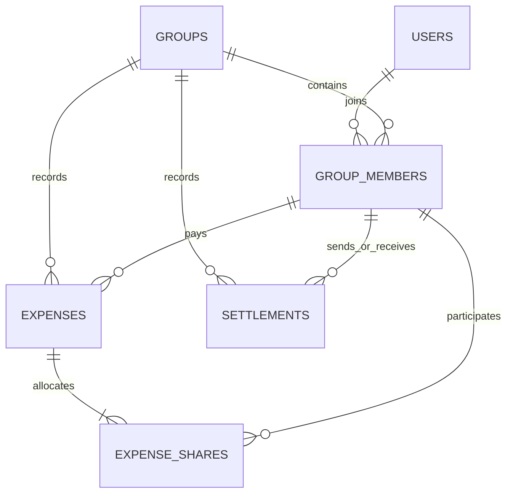

# Expense Sharing App

FastAPI expense-sharing backend planned with exact monetary accounting, searchable history, explainable spending analytics, and settlement suggestions.

**Status: design phase. Application code has deliberately not been built.** The architecture below is a recommendation for discussion, not an implemented feature list. FastAPI and a public GitHub repository named `expense-sharing-app` are requested choices; the remaining technical choices are proposals.

## Assignment scope

The planned submission covers users, groups, membership, equal shared expenses, history, structured balances, search, spending analytics, category suggestions, settlement suggestions, recorded settlements, custom splits, tests, and Docker support.

Search is the nominated mandatory product enhancement. Analytics and settlement suggestions are additional enhancements. Custom splits, settlements, tests, and Docker cover every optional bonus in the assignment.

## Recommended stack

| Component | Choice | Reason / cost |
| --- | --- | --- |
| Backend | Python + FastAPI | Familiar framework; typed validation and generated OpenAPI documentation |
| Validation/configuration | Pydantic v2 + pydantic-settings | Explicit request/response contracts and environment configuration |
| Persistence | PostgreSQL | Transactions, constraints, reporting SQL, and row locking in one database |
| ORM | SQLAlchemy 2, synchronous sessions | Explicit transactions; less concurrency plumbing for a small assignment |
| Driver | Psycopg 3 | PostgreSQL driver; binary installation variant for a quick local setup |
| Migrations | Alembic | Reviewable, reproducible database changes |
| Server | Uvicorn | ASGI server for FastAPI |
| Tests | pytest + HTTPX / FastAPI TestClient | Pure accounting tests plus API/database integration tests |
| Tooling | Ruff | One formatter/linter, minimal configuration |
| Packaging | pyproject.toml + a generated, pinned dependency lock/export | Reproducible runtime and development installs |
| Delivery | Dockerfile + Docker Compose | API and PostgreSQL; persistent database volume |

Choose concrete compatible versions and generate the dependency lock when implementation starts. No dependencies have been installed or version-tested yet.

FastAPI documents its OpenAPI and interactive documentation support in its [official features guide](https://fastapi.tiangolo.com/features/). SQLAlchemy documents the [transaction context](https://docs.sqlalchemy.org/en/20/orm/session_transaction.html) used by the proposed service layer; Alembic provides [schema migrations](https://alembic.sqlalchemy.org/en/latest/).

### Why a relational database rather than a graph database?

Users and groups have relationships, but the required queries are membership lookups, time-ordered history, sums, and balance calculations. None requires repeated multi-hop social traversal. The workload does not establish that a graph database would be faster. A graph database would introduce another query model and make the listed SQL database options less directly applicable.

PostgreSQL stores relationships using foreign keys and association tables. We can construct a debt graph in memory when generating settlement suggestions. This demonstrates graph reasoning without adding an operational dependency.

SQLite is a valid fallback if zero-service startup matters more than concurrent settlement handling. It is not a second supported backend in the initial plan: supporting and testing two databases spends time without helping this assignment. If selected instead, enable foreign keys on every connection and revisit write concurrency; see [SQLite foreign key documentation](https://www.sqlite.org/foreignkeys.html). PostgreSQL is the recommendation for Docker-based evaluation.

## Architecture

One application, one database, and four straightforward layers:

```text
HTTP request -> FastAPI router + Pydantic validation
             -> application service (business rules + transaction)
             -> SQLAlchemy queries/models -> PostgreSQL

Application services -> pure money/split/balance/category/settlement functions
```

Use ordinary synchronous route functions for synchronous database calls. One session per request; write services own commit/rollback boundaries. Pure accounting functions do not know about FastAPI or the database. Keep queries in feature modules; avoid generic repository abstractions until duplication warrants them.

No microservices, message broker, cache, external search service, or language model is necessary. See [flow.md](flow.md) for proposed modules and function-by-function flows, and [decisions.md](decisions.md) for reasons and tradeoffs.

## Proposed database design



| Table | Important fields | Constraints / purpose |
| --- | --- | --- |
| `users` | `id`, `name`, `created_at` | Nonblank trimmed name; names need not be unique |
| `groups` | `id`, `name`, `currency`, `timezone`, `created_at` | INR only initially; reporting timezone defaults to Asia/Kolkata |
| `group_members` | `group_id`, `user_id`, `joined_at` | Composite primary key `(group_id, user_id)`; foreign keys to users/groups |
| `expenses` | `id`, `group_id`, `paid_by`, `amount_minor`, `description`, `split_type`, `category`, `category_source`, `category_rule`, `occurred_at`, `created_at` | Positive amount; membership FK `(group_id, paid_by)`; unique `(id, group_id)` for share FK |
| `expense_shares` | `expense_id`, `group_id`, `user_id`, `amount_minor` | Primary key `(expense_id, user_id)`; amount >= 0; composite FKs to expense/group and group/member |
| `settlements` | `id`, `group_id`, `from_user_id`, `to_user_id`, `amount_minor`, `mode`, `note`, `occurred_at`, `created_at` | Amount > 0; sender != receiver; direct/simplified mode; both parties reference group membership |

All entity IDs are integer primary keys. All event timestamps are timezone-aware UTC. Monetary columns use `BIGINT` minor units (paise). Category is a small application enum persisted as text with a check constraint, avoiding a category management subsystem. `category_rule` stores the matched rule identifier/version or null, not an invented confidence score.

Foreign keys use restrictive deletion. There are no membership removal or financial record deletion endpoints in the first version. Keep indexes on `(group_id, occurred_at, id)` for expenses and settlements, `(user_id, group_id)` for memberships, `(user_id, expense_id)` for shares, and `(group_id, paid_by)` for payer aggregations. Primary/unique keys already cover common joins. Add text indexes only after a real search workload justifies them.

The sum of expense shares is a cross-row invariant: validate it in the service, write expense and shares in one transaction, and test it. A row-level `CHECK` alone cannot enforce that sum. The same transaction snapshots all current members. Never recalculate historical shares from today's membership.

Balances are derived from expenses, saved shares, and settlements; do not maintain mutable balance rows that can drift from history.

## Accounting rules and assumptions

1. Amount must be positive, finite, no more than two decimal places, and within a documented maximum chosen before implementation. Reject excess precision rather than silently rounding user input.
2. Prefer decimal strings in JSON (`"1200.00"`). Accept the assignment's numeric JSON form through Decimal validation, without float arithmetic. Convert to integer paise once at the boundary; return monetary strings consistently.
3. Group must exist, contain at least one member, and include the payer.
4. Default `split_type` is `equal`. All current group members participate, including the payer. The equal endpoint accepts no participant subset or explicit shares.
5. Divide paise using quotient and remainder. For 100.00 across three users ordered by ID, store 33.34, 33.33, 33.33. Exact equality below a paisa is impossible; allocations differ by at most one paisa and sum exactly to the amount. Fixed ID order is reproducible but slightly favors later IDs over many expenses; rotating remainders is deferred.
6. Save the payer's own consumption share for analytics, but create no self-debt. A one-member group has an expense and a share but zero debt.
7. Custom splitting is a separate, explicit bonus mode. Require every current member exactly once, allow zero shares, reject outsiders/duplicates, and require the exact sum to match the expense. This preserves the assignment's equal behavior as the default. If an evaluator interprets equal splitting as universal, they can exercise only equal mode.
8. New members participate in future expenses only. No retroactive custom participants, member removal, currency conversion, or partial expense updates in this version. Backdated events use membership at recording time, not reconstructed historical membership.
9. Expenses and settlements are financially immutable. Category correction is allowed because it does not change accounting. Reversal/correction records can be added later.
10. The demo has no authentication: user IDs are identifiers, not proof of identity. APIs operate on synthetic assignment data. A future authenticated version must enforce group access consistently, including search and analytics.

## Balances and settlements

For a member, positive net balance means they should receive money:

```text
net = expenses_paid - allocated_shares + settlements_sent - settlements_received
```

Across a group, all net balances must sum to zero. For Mohit's 1200.00 dinner, the positions are Mohit +800.00, Rahul -400.00, Ankit -400.00.

Provide two explicitly labelled views:

- **Direct balances:** per-member-to-payer obligations from expense shares, reduced by opposite obligations and recorded transfers. They explain original relationships. No self-edges; omit zero edges.
- **Net positions and simplified settlement plan:** group-wide positions plus proposed transfers that clear those positions. A member may pay someone who did not originally pay for their expense.

Simplified settlement matches the largest debtor with the largest creditor for `min(debt, credit)`, with user ID as a deterministic tiebreaker. Use heaps, O(n log n) after aggregation, and at most n-1 transfers for n nonzero positions. This is a practical short plan, **not a guarantee of the mathematical minimum transaction count**. Suggestions are computed on demand and never recorded automatically.

Example: A owes B 100.00 and B owes C 100.00. Direct mode proposes A -> B and B -> C. Simplified mode proposes A -> C 100.00. After that transfer all net positions are zero, while historical pairwise accounting can contain a zero-net cycle. Mark the group settled based on net positions; do not present the historical cycle as new money that must be paid.

Recording a settlement requires explicit `mode: "direct"` or `"simplified"`. Direct mode caps payment at the current direct debt to that recipient. Simplified mode requires sender net < 0, receiver net > 0, and amount <= min(sender debt, receiver credit). A group-row lock serializes all financial writes and membership additions before reading balances/membership and writing. This avoids simultaneous settlements both passing a stale balance check; the small-group tradeoff is serial writes within one group. See [PostgreSQL row-level locking](https://www.postgresql.org/docs/current/explicit-locking.html).

Settlement means recording a payment made outside this service (cash, UPI, bank transfer); the API does not move money or verify bank receipt. A preview is advisory; the POST revalidates against current state and returns 409 if the balance has changed incompatibly. Cross-group netting is deferred even when two users share several groups.

## Proposed API

All application routes use `/api/v1`. Collections return `{ "items": [...], "limit": 20, "offset": 0, "total": 3 }`; default limit 20, maximum 100; stable ordering includes ID as a tiebreaker.

| Method | Path | Behavior |
| --- | --- | --- |
| POST / GET | `/users` | Create / list users; optional name query |
| GET | `/users/{user_id}` | User detail |
| POST / GET | `/groups` | Create / list groups; optional `user_id`, `q` filters |
| GET | `/groups/{group_id}` | Group detail and member count |
| PUT | `/groups/{group_id}/members/{user_id}` | Idempotently add an existing user; no duplicate membership |
| GET | `/groups/{group_id}/members` | Paginated members |
| POST / GET | `/groups/{group_id}/expenses` | Record / list expenses; group ID appears only in path |
| GET | `/groups/{group_id}/expenses/{expense_id}` | Expense with payer and saved shares; enforce group match |
| PATCH | `/groups/{group_id}/expenses/{expense_id}/category` | Correct category; mark source manual |
| GET | `/groups/{group_id}/balances` | `view=direct` or `view=net`; default direct for assignment compatibility |
| GET | `/groups/{group_id}/settlement-suggestions` | `mode=direct` or `simplified`; default simplified; no write |
| POST / GET | `/groups/{group_id}/settlements` | Record / list payments, including partial settlements |
| GET | `/users/{user_id}/balances` | Positions and dues grouped by group; never collapse currencies/groups |
| GET | `/users/{user_id}/analytics` | Personal share spend, paid amounts, settlement cash flow, category/month/group breakdowns |
| GET | `/groups/{group_id}/analytics` | Group expense totals, category/month/member breakdowns |
| GET | `/search` | `q`, `types`, optional `group_id` / `user_id`; typed search results |
| GET | `/categories` | Supported categories and classification explanation |
| GET | `/health/live`, `/health/ready` | Process / database availability, outside `/api/v1` |

Expense history filters: `q`, `category`, `paid_by`, `from`, `to`, `limit`, `offset`. Analytics accept `from`, `to`, `bucket=month`, and optional group filter for a user. Date intervals are start-inclusive/end-exclusive; convert reporting dates in the requested/default group timezone to UTC before querying. Use full history for current balances, independently of analytics date filters.

Use 201 for creation, 200 for reads/existing membership, and 201 for newly created membership. Use 404 for missing resources, 422 for malformed fields/nonpositive amount/invalid split shape, and 409 for state conflicts such as nonmember payer or settlement beyond current debt. Errors have a consistent `{ "error": { "code", "message", "details" } }` envelope, including adapted framework validation errors. IDs identify people; names remain display fields, avoiding collisions in the assignment's name-keyed example.

### Expense examples

```json
{
  "paid_by": 1,
  "amount": "1200.00",
  "description": "Dinner",
  "split_type": "equal"
}
```

Sent to `POST /api/v1/groups/1/expenses`. Category can be omitted for classification or supplied explicitly. A custom request uses a discriminated schema:

```json
{
  "paid_by": 1,
  "amount": "1000.00",
  "description": "Activities",
  "split_type": "custom",
  "splits": [
    {"user_id": 1, "amount": "500.00"},
    {"user_id": 2, "amount": "300.00"},
    {"user_id": 3, "amount": "200.00"}
  ]
}
```

Direct balance response for the dinner:

```json
{
  "group_id": 1,
  "currency": "INR",
  "view": "direct",
  "is_settled": false,
  "balances": [
    {"from_user": {"id": 2, "name": "Rahul"}, "to_user": {"id": 1, "name": "Mohit"}, "amount": "400.00"},
    {"from_user": {"id": 3, "name": "Ankit"}, "to_user": {"id": 1, "name": "Mohit"}, "amount": "400.00"}
  ]
}
```

A recorded settlement uses `{ "from_user_id": 2, "to_user_id": 1, "amount": "400.00", "mode": "direct", "note": "UPI payment received" }`. Rahul's remaining debt becomes zero. `mode` is also stored on the settlement record to explain validation semantics.

## Search and analytics enhancements

### Search across data and product features

Search groups by name, users by name, expenses by description/category, and a small static feature directory by labels/aliases. Searching `settle` can return the settlement feature; `Goa` can return a group and matching expenses. Feature entries contain a stable key and API path template, not invented frontend URLs. Return typed hits with IDs, display labels, match fields, and deterministic ranking (exact, prefix, substring), then ID/type tiebreakers.

Start with parameterized, escaped, case-insensitive substring SQL and query length 1-100 after trimming, plus in-memory matching for the small feature directory. `%` and `_` in a query are literals, not wildcard instructions. Define combined pagination over the ranked hits rather than returning an unbounded list per type; cap search offset at 1000 to bound the initial merge algorithm. A `user_id` filter narrows data to that user's groups but is not authentication. Search the user's own user record and peers in those groups; feature hits remain global. A `group_id` filter restricts group/member/expense hits to that group. If both filters are present, intersect them.

At demo scale this avoids search infrastructure. For larger datasets PostgreSQL has [trigram indexes and similarity search](https://www.postgresql.org/docs/current/pgtrgm.html); implementing them is deferred, not claimed as present. Substring scans are an explicit initial tradeoff.

### Explainable categorization

Categories: travel, food, accommodation, activities, shopping, other. Use a versioned keyword/phrase dictionary with word boundaries and explicit precedence; normalize Unicode/case/punctuation. `auto`, `cab`, `bike`, `taxi`, `flight`, `train`, and `bus` suggest travel; dinner/restaurant suggest food; hotel/stay suggest accommodation. Explicit user choice overrides automation. If multiple different categories match without a more specific phrase resolving ambiguity, choose other and expose why; unknown descriptions also fall back to other.

Store chosen category, source (`manual`, `rule`, `fallback`), and rule version/identifier with the expense. GET never silently reclassifies old records. Rules are transparent and easy to test but cannot understand ambiguous context such as bike purchase versus bike rental; manual correction handles this limitation. No paid API, model training, or unverifiable precision claim is needed.

### Analytics that do not confuse spending with paying

For the dinner, Mohit **paid 1200.00** but **personally spent 400.00**. Rahul paid 0.00 but spent 400.00. Reports show these separately:

- Personal spending = saved expense shares, grouped by category, month, and group.
- Paid on behalf of the group = expense amounts paid by that user.
- Settlements sent/received = reimbursement cash flows; never new spending.
- Net cash outflow = paid + settlements sent - settlements received.
- Current net balance = lifetime group position; labelled separately from a filtered period's totals.
- Group spend = each expense counted once. Join/aggregate shares carefully to avoid multiplying expense totals by member count.

Include totals, category amounts/percentages, monthly series, group breakdown, and largest expenses; paginate drill-downs. Define zero-total percentages as zero. These are descriptive analytics, not forecasts or financial advice.

## Tests and demo evidence planned

- Assignment's 1200.00 example; reciprocal debt cancellation; several payers; self-share excluded from debts; one-member group.
- Nonpositive/nonfinite/overprecision amounts; nonexistent group/user; nonmember payer; empty group; wrong-group resource IDs.
- Remainder allocation, small amounts smaller than member count, exact share sum, zero-sum group positions.
- Custom splits with zero share, duplicates, outsiders, omitted members, and incorrect totals.
- Membership added after an expense leaves historical shares and balances unchanged.
- Partial/full/oversized/self/nonmember settlements; simplified chain; zero-net cycle; two concurrent settlements against the same debt.
- Suggested transfers conserve balances, never pay oneself, and clear a copied set of positions without changing stored history.
- Search filters, wildcard escaping, duplicate names, deterministic pagination, and ambiguous category/manual override behavior.
- Analytics distinguish paid/share/cash flow, avoid duplicate sums, and handle date boundaries/empty periods.
- Integration tests use isolated PostgreSQL state, apply migrations, and exercise API responses and constraints; pure math tests need no database.

## Planned setup and submission

There is no runnable service, Dockerfile, dependency lock, or test suite yet. The following are intended deliverables/commands, **not currently working setup instructions**:

1. Supply `.env.example`, validated settings, pinned dependencies, Dockerfile, and Compose configuration.
2. `docker compose up --build`: database health check, one migration step, then API startup.
3. Open `http://localhost:8000/docs` for interactive OpenAPI; `/redoc` and `/openapi.json` also documented.
4. Run the documented pytest command against a separate disposable test database; never reset the developer database from tests.
5. Supply a repeatable demo seed command for Mohit/Rahul/Ankit and representative search/analytics records.
6. Add exact local Python setup, migration, seed, test, and Docker commands after verifying them.

GitHub target: public repository `expense-sharing-app`. Suggested repository description: **FastAPI expense-sharing backend with exact split accounting, searchable expenses, spending analytics, and smart settlement suggestions.** Do not claim implemented features in repository release notes until built.

## Suggested 12-hour implementation budget

| Time | Deliverable |
| --- | --- |
| 0-1 h | Skeleton, settings, database models, initial migration |
| 1-3 h | Users, groups, memberships, equal/custom expenses and history |
| 3-5 h | Balance engine, suggestions, partial/full settlements and transaction rules |
| 5-6 h | Unified search and explainable category rules |
| 6-8 h | Share-based analytics and drill-down filters |
| 8-10 h | Focused unit/integration tests, especially money and settlements |
| 10-12 h | Docker verification, seed demo, documentation, repository polish |

This is a target rather than a guarantee. The requested extras fill the available time; preserve correctness and the requested bonuses before polishing analytics ranking or adding more features.

Quick follow-ups, ordered by value: CSV export (about 30-45 minutes plus escaping/formula-injection handling), duplicate-expense warning (30-60 minutes, advisory only), group budget with remaining amount (45-60 minutes), and GitHub CI for lint/tests (30-60 minutes once Docker tests work). These estimates are tentative; none is committed to the initial 12-hour scope. Idempotent expense/settlement POSTs are valuable but need payload-bound keys and concurrency tests, so budget them separately rather than calling them a trivial header change.

With more time: financial reversal records, authentication/group authorization, idempotency, fuzzy search, membership departure rules, receipt attachments, budgets, richer category context, and measured performance improvements. Notifications, bank integrations, OCR, multiple currencies, and exact minimum-transfer optimization are outside the initial assignment scope.
